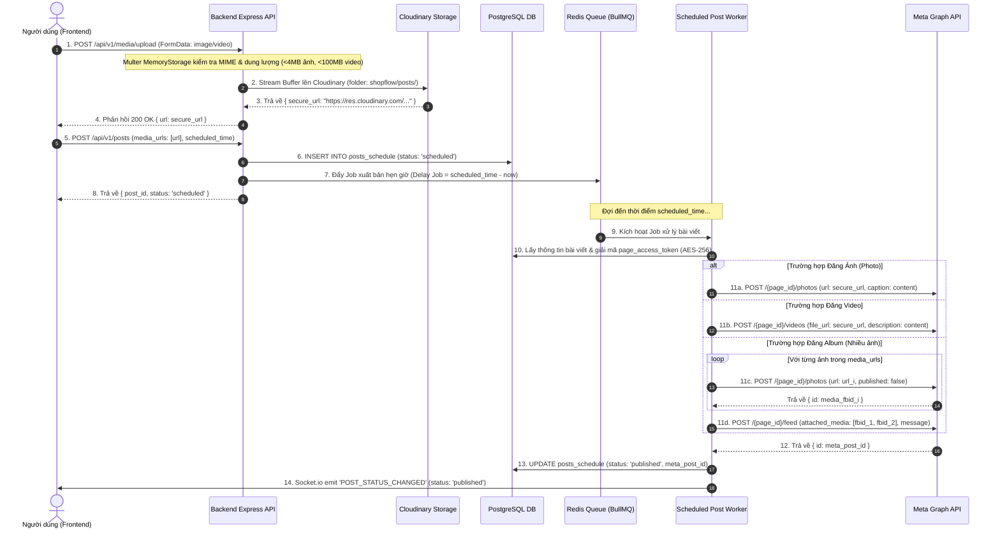

# ĐẶC TẢ REST API NỘI BỘ, WEBSOCKET & QUẢN LÝ MEDIA
## DỰ ÁN QUẢN LÝ FANPAGE FACEBOOK & TỰ ĐỘNG HÓA BÁN HÀNG

Tài liệu này đặc tả toàn bộ giao ước truyền thông giữa Frontend (Next.js) và Backend (Express.js), cùng các sự kiện thời gian thực (Socket.io) và quy trình xử lý phương tiện media phục vụ xuất bản bài viết lên Meta Graph API.

---

### I. CẤU TRÚC JSON RESPONSE CHUẨN CHUNG (Standard API Response Envelope)

Mọi endpoint REST API trả về đều tuân thủ chặt chẽ định dạng bao gói chuẩn:

#### 1. Trường hợp Thành Công (Success Format - HTTP 200/201)
```json
{
  "success": true,
  "data": {
    "id": "c1f7a0b5-7798-444b-9706-92f7d1bc9891",
    "name": "Shop Thời Trang Trẻ"
  },
  "meta": {
    "page": 1,
    "limit": 20,
    "total": 85,
    "totalPages": 5
  }
}
```
*(Ghi chú: Trường `meta` là tùy chọn, chỉ xuất hiện ở các API có phân trang).*

#### 2. Trường hợp Thất Bại (Error Format - HTTP 4xx/5xx)
```json
{
  "success": false,
  "error": {
    "code": "VALIDATION_ERROR",
    "message": "Dữ liệu yêu cầu không hợp lệ",
    "details": [
      {
        "field": "scheduled_time",
        "message": "Thời gian đăng bài phải cách thời điểm hiện tại ít nhất 10 phút"
      }
    ]
  }
}
```

#### 3. Bảng Mã Lỗi Nội Bộ (`AppErrorCode`)
| HTTP Code | Error Code | Mô tả |
| :--- | :--- | :--- |
| **400** | `BAD_REQUEST` | Tham số hoặc cú pháp gửi lên không đúng |
| **401** | `UNAUTHORIZED` | Thiếu hoặc token đăng nhập (JWT) hết hạn |
| **403** | `FORBIDDEN` | Không có quyền thao tác trên tài nguyên này |
| **404** | `NOT_FOUND` | Không tìm thấy bản ghi (User/Page/Post/Conversation) |
| **409** | `CONFLICT` | Trùng lặp dữ liệu (Email hoặc Page ID đã tồn tại) |
| **422** | `VALIDATION_ERROR` | Dữ liệu không thỏa mãn ràng buộc Zod Schema |
| **429** | `RATE_LIMITED` | Vượt quá giới hạn tần suất gọi API |
| **502** | `META_API_ERROR` | Meta Graph API từ chối hoặc trả về mã lỗi bên thứ 3 |
| **500** | `INTERNAL_SERVER_ERROR` | Lỗi máy chủ chưa được xử lý ngoại lệ |

---

### II. BẢNG DANH MỤC REST API NỘI BỘ (Internal REST API Endpoints)

#### Nhóm 1: Xác thực & Người dùng (`/api/v1/auth`)
| Method | Endpoint | Yêu cầu Auth | Mô tả & Schema | Response Data |
| :--- | :--- | :---: | :--- | :--- |
| `POST` | `/register` | Không | Body: `{ email, password, full_name }` (Password min 8 ký tự) | `{ user: { id, email, full_name, role } }` |
| `POST` | `/login` | Không | Body: `{ email, password }` | `{ user, accessToken }` + Cookie HttpOnly `refreshToken` |
| `GET` | `/me` | Có (Bearer) | Header: `Authorization: Bearer <accessToken>` | `{ user: { id, email, full_name, role } }` |
| `POST` | `/refresh-token` | Không | Cookie: `refreshToken` | `{ accessToken }` |
| `POST` | `/logout` | Có (Bearer) | Hủy phiên đăng nhập và xóa Cookie refresh | `{ message: "Đăng xuất thành công" }` |

#### Nhóm 2: Meta Facebook OAuth (`/api/v1/fb-oauth`)
| Method | Endpoint | Yêu cầu Auth | Mô tả & Schema | Response Data |
| :--- | :--- | :---: | :--- | :--- |
| `GET` | `/connect-url` | Có (Bearer) | Sinh URL xác thực Meta OAuth 2.0 kèm `state` CSRF token | `{ authUrl: "https://www.facebook.com/v19.0/dialog/oauth?..." }` |
| `GET` | `/callback` | Không | Nhận `code` và `state` từ Meta redirect về, đổi sang Long-Lived Token, lưu danh sách Pages | Redirect về Frontend Dashboard kèm trạng thái thành công |
| `GET` | `/accounts` | Có (Bearer) | Lấy danh sách Pages mà tài khoản Facebook đang quản lý | `{ pages: [{ page_id, page_name, avatar_url, is_connected }] }` |
| `POST` | `/connect-pages` | Có (Bearer) | Body: `{ page_ids: string[] }` - Lưu vào `connected_pages` & gọi Meta Subscribed Apps | `{ connectedCount: number, pages: [...] }` |

#### Nhóm 3: Quản lý Fanpage & Automation Rules (`/api/v1/pages`)
| Method | Endpoint | Yêu cầu Auth | Mô tả & Schema | Response Data |
| :--- | :--- | :---: | :--- | :--- |
| `GET` | `/` | Có (Bearer) | Lấy danh sách Fanpage đã kết nối của người dùng | `{ pages: [ { id, page_id, page_name, avatar_url, is_active, webhook_subscribed } ] }` |
| `GET` | `/:pageId` | Có (Bearer) | Xem chi tiết trạng thái kết nối và số liệu tổng quan của Page | `{ page: { ... }, stats: { totalPosts, totalConversations } }` |
| `PATCH` | `/:pageId/status` | Có (Bearer) | Body: `{ is_active: boolean }` - Tạm dừng/Bật xử lý Page | `{ page: { id, is_active } }` |
| `POST` | `/:pageId/subscribe-webhook` | Có (Bearer) | Gọi lại Meta API `POST /{page_id}/subscribed_apps` | `{ webhook_subscribed: true }` |
| `DELETE` | `/:pageId` | Có (Bearer) | Hủy kết nối Fanpage khỏi hệ thống | `{ message: "Đã hủy kết nối Fanpage" }` |
| `GET` | `/:pageId/rules` | Có (Bearer) | Lấy danh sách quy tắc Automation của Fanpage | `{ rules: [ { id, rule_name, hide_phone_enabled, trigger_keywords, ... } ] }` |
| `POST` | `/:pageId/rules` | Có (Bearer) | Body: `{ rule_name, hide_phone_enabled, trigger_keywords, auto_comment_template, auto_private_reply_template, is_active }` | `{ rule: { ... } }` |
| `PUT` | `/:pageId/rules/:ruleId` | Có (Bearer) | Cập nhật cấu hình quy tắc tự động | `{ rule: { ... } }` |
| `DELETE` | `/:pageId/rules/:ruleId` | Có (Bearer) | Xóa một quy tắc tự động | `{ message: "Đã xóa quy tắc" }` |

#### Nhóm 4: Đặt lịch Bài viết (`/api/v1/posts`)
| Method | Endpoint | Yêu cầu Auth | Mô tả & Schema | Response Data |
| :--- | :--- | :---: | :--- | :--- |
| `GET` | `/` | Có (Bearer) | Query: `page_id?`, `status?`, `from?`, `to?`, `page=1`, `limit=20` | `{ posts: [ { id, content_text, media_type, media_urls, scheduled_time, status } ], meta }` |
| `GET` | `/:postId` | Có (Bearer) | Lấy chi tiết bài viết đặt lịch | `{ post: { ... } }` |
| `POST` | `/` | Có (Bearer) | Body: `{ page_id: UUID, content_text: string, media_type: 'none'\|'photo'\|'video', media_urls: string[], scheduled_time: ISOString }` | `{ post: { id, status: 'scheduled' } }` |
| `PUT` | `/:postId` | Có (Bearer) | Sửa bài viết (chỉ cho phép khi `status = 'pending'` hoặc `'scheduled'`) | `{ post: { ... } }` |
| `DELETE` | `/:postId` | Có (Bearer) | Hủy bài viết đặt lịch | `{ message: "Đã hủy lịch đăng bài" }` |
| `POST` | `/:postId/retry` | Có (Bearer) | Đẩy lại bài viết bị lỗi (`status = 'failed'`) vào hàng đợi xuất bản | `{ message: "Đã đưa bài viết vào hàng đợi đăng lại" }` |

#### Nhóm 5: Hộp thư Tập trung & Khách hàng (`/api/v1/inbox`)
| Method | Endpoint | Yêu cầu Auth | Mô tả & Schema | Response Data |
| :--- | :--- | :---: | :--- | :--- |
| `GET` | `/conversations` | Có (Bearer) | Query: `page_id?`, `type?` (`messenger`\|`comment_thread`), `status?`, `search?`, `page`, `limit` | `{ conversations: [ { id, customer, last_message_text, unread_count, window_24h_expires_at } ], meta }` |
| `GET` | `/conversations/:conversationId` | Có (Bearer) | Chi tiết hội thoại kèm thông tin khách hàng và trạng thái cửa sổ 24h | `{ conversation: { ... }, customer: { ... }, is_within_24h: boolean }` |
| `GET` | `/conversations/:conversationId/messages` | Có (Bearer) | Query: `cursor?`, `limit=50` - Lấy danh sách tin nhắn/comment | `{ messages: [ { id, meta_id, sender_type, content, is_hidden, created_at } ], nextCursor }` |
| `POST` | `/conversations/:conversationId/messages` | Có (Bearer) | Body: `{ content: string, media_url?: string }` - Nhân viên gửi tin nhắn trả lời | `{ message: { id, sender_type: 'page', content, created_at } }` |
| `POST` | `/messages/:messageId/private-reply` | Có (Bearer) | Body: `{ content: string }` - Gửi Private Reply cho một Comment | `{ success: true, message: "Đã gửi tin nhắn riêng tới khách hàng" }` |
| `PATCH` | `/messages/:messageId/hide` | Có (Bearer) | Body: `{ is_hidden: boolean }` - Ẩn/Hiện thủ công bình luận trên Facebook | `{ message: { id, is_hidden } }` |
| `PATCH` | `/conversations/:conversationId/status` | Có (Bearer) | Body: `{ status: 'open' \| 'resolved' \| 'archived' }` | `{ conversation: { id, status } }` |
| `PATCH` | `/customers/:customerId` | Có (Bearer) | Body: `{ customer_name?, phone_number?, address?, tags?: string[], notes? }` | `{ customer: { ... } }` |

#### Nhóm 6: Tải lên Phương tiện (`/api/v1/media`)
| Method | Endpoint | Yêu cầu Auth | Mô tả & Schema | Response Data |
| :--- | :--- | :---: | :--- | :--- |
| `POST` | `/upload` | Có (Bearer) | `multipart/form-data`, trường `file`. Hỗ trợ ảnh (`<4MB`) hoặc video (`<100MB`) | `{ url: "https://res.cloudinary.com/...", public_id: "...", media_type: "photo" }` |

---

### III. ĐẶC TẢ GIAO TIẾP THỜI GIAN THỰC QUA WEBSOCKET (Socket.io Events)

#### 1. Cơ chế Xác thực & Quản lý Phòng (Rooms)
* Client kết nối Socket.io kèm JWT Token: `io(SOCKET_URL, { auth: { token: 'Bearer <JWT>' } })`.
* Sau khi xác thực, Server tự động gán Socket vào các phòng tương ứng:
  * `room:user_{user_id}`: Nhận các thông báo chung toàn tài khoản.
  * `room:page_{page_id}`: Nhận các luồng tin nhắn/bình luận theo từng Fanpage cụ thể.
* Client có thể gửi event `join_conversation` / `leave_conversation` với `{ conversationId }` khi người dùng mở khung chat chi tiết.

#### 2. Sự kiện 1: `NEW_INBOX_ITEM` (Khi có bình luận hoặc tin nhắn mới)
Phát khi Webhook Worker tiếp nhận và bóc tách thành công bình luận hoặc tin nhắn từ khách hàng:

```json
{
  "event": "NEW_INBOX_ITEM",
  "page_id": "102938475612345",
  "conversation_id": "8e3b1c20-a619-4821-b3b4-e40df8f44d12",
  "type": "comment_thread",
  "customer": {
    "id": "7fa123bc-9988-4e12-b123-c45d6e7f8a9b",
    "customer_fb_id": "987654321012345",
    "customer_name": "Trần Thị Mai",
    "phone_number": "0987654321",
    "tags": ["Co_SDT"]
  },
  "message": {
    "id": "b3e210ac-4412-4c23-99ab-123456789abc",
    "meta_id": "102938475612345_1234567890",
    "sender_type": "customer",
    "sender_fb_id": "987654321012345",
    "content": "Bao nhiêu 1 set vậy shop? SĐT mình 0987654321",
    "is_hidden": true,
    "private_reply_sent": true,
    "media_payload": {},
    "created_at": "2026-10-19T05:43:00.000Z"
  },
  "unread_count": 1,
  "window_24h_expires_at": null
}
```

#### 3. Sự kiện 2: `INBOX_UPDATED` (Cập nhật trạng thái hội thoại hoặc thông điệp)
Phát khi nhân viên xử lý xong hội thoại, hệ thống tự động ẩn comment, gửi tin nhắn tự động thành công, hoặc cập nhật thẻ tag khách:

```json
{
  "event": "INBOX_UPDATED",
  "page_id": "102938475612345",
  "conversation_id": "8e3b1c20-a619-4821-b3b4-e40df8f44d12",
  "updated_fields": {
    "status": "resolved",
    "unread_count": 0,
    "last_message_text": "Shop đã gửi báo giá qua inbox cho bạn rồi nhé!",
    "last_message_at": "2026-10-19T05:43:04.000Z",
    "tags": ["Co_SDT", "Da_Bao_Gia"]
  }
}
```

#### 4. Sự kiện 3: `POST_STATUS_CHANGED` (Cập nhật trạng thái bài viết đặt lịch)
Phát khi Worker xuất bản bài viết thành công lên Meta hoặc gặp lỗi Rate Limit/Token:

```json
{
  "event": "POST_STATUS_CHANGED",
  "post_id": "550e8400-e29b-41d4-a716-446655440000",
  "page_id": "102938475612345",
  "status": "published",
  "meta_post_id": "102938475612345_9988776655",
  "error_message": null,
  "published_at": "2026-10-19T06:00:02.000Z"
}
```

---

### IV. GIẢI PHÁP LƯU TRỮ MEDIA (Media Upload & Storage Flow)

#### 1. Ràng buộc Kỹ thuật & Yêu cầu của Meta Graph API
* Khi xuất bản bài viết qua Meta Graph API:
  * **Hình ảnh (`POST /{page_id}/photos`):** Yêu cầu tham số `url` trỏ tới một liên kết **Public HTTPS** có thể tải được trực tiếp bởi máy chủ Meta, định dạng JPG/PNG/WEBP, dung lượng tối đa **4MB**.
  * **Video (`POST /{page_id}/videos`):** Yêu cầu tham số `file_url` trỏ tới đường dẫn HTTPS công khai, định dạng MP4/MOV, dung lượng tối đa **1GB**, thời lượng tối đa 20 phút.
  * **Bài viết đính kèm nhiều ảnh (Album/Carousel):** Phải upload từng ảnh với `published=false` lên `/{page_id}/photos` để nhận về mảng `media_fbid`, sau đó tạo bài viết tại `/{page_id}/feed` với tham số `attached_media: [{"media_fbid":"id1"}, {"media_fbid":"id2"}]`.

#### 2. Thiết kế Kiến trúc Lưu trữ: Multer + Cloudinary
* Lựa chọn **Cloudinary** làm kho lưu trữ đám mây trung gian:
  * Đảm bảo luôn tạo ra URL chuẩn HTTPS công khai (`secure_url`), tốc độ phân phối nhanh qua CDN toàn cầu.
  * Tự động nén và tối ưu hóa ảnh (`f_auto,q_auto`) giúp giảm thời gian Meta tải ảnh về máy chủ.
  * Tách biệt hoàn toàn máy chủ Backend khỏi việc gánh tải file dung lượng lớn.
* **Chi tiết luồng xử lý tại Backend:**
  1. Frontend gửi yêu cầu `POST /api/v1/media/upload` kiểu `multipart/form-data`.
  2. Middleware `multer` cấu hình `memoryStorage()` giữ file dưới dạng Buffer trong RAM.
  3. Service stream trực tiếp buffer lên Cloudinary thông qua SDK `cloudinary.v2.uploader.upload_stream`.
  4. Trả về `secure_url` cho Frontend để xem trước (Preview) và đính kèm vào mảng `media_urls` khi bấm "Lên lịch đăng bài".

#### 3. Sơ đồ Tuần tự Chi tiết (Sequence Diagram)



---

### V. GHI CHÚ TRIỂN KHAI CHO AI CODING AGENT
1. Mọi DTO gửi/nhận giữa Frontend và Backend phải sử dụng chung cấu trúc trong `types/api.ts` và `types/inbox.ts`.
2. Mọi route API mới phát sinh bắt buộc phải đi qua middleware `validateRequest` với Zod schema tương ứng.
3. Khi xử lý logic liên quan đến Meta Graph API, worker bắt buộc phải bao bọc trong cấu hình retry của BullMQ với Exponential Backoff đã quy định tại `02_ARCHITECTURE_AND_FLOWS.md`.
